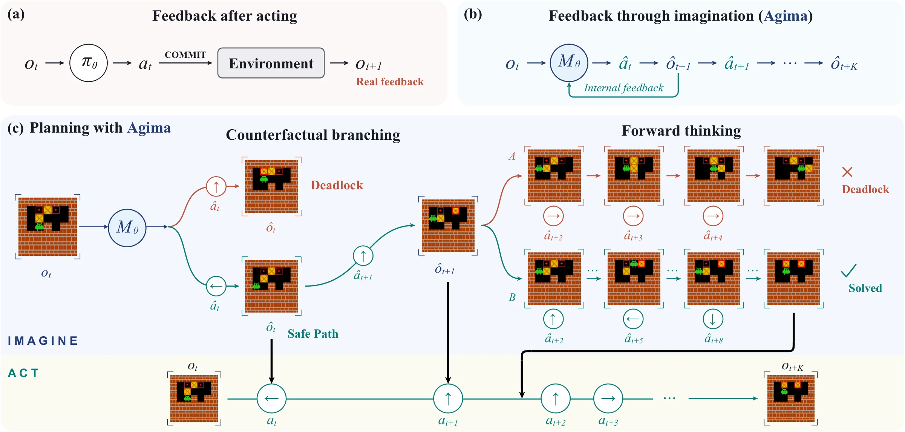

<p align="center">
  <a href="https://agima.net/"></a>
</p>

<h1 align="center">Training an Imaginative Agent</h1>

<p align="center"><strong>Agentic Imagination (Agima)</strong><br>Learning to act by imagining what comes next.</p>

<p align="center">
  <a href="https://gejiaxin.org/">Jiaxin Ge</a><sup>1,*</sup> &nbsp;
  <a href="https://www.junyi42.com/">Junyi Zhang</a><sup>1,*</sup> &nbsp;
  <a href="https://agima.net/">Tianning Chai</a><sup>1,*</sup> &nbsp;
  <a href="https://github.com/lukehanjun">Hanjun Yoo</a><sup>1</sup><br>
  <a href="https://agima.net/">Chenyang Wang</a><sup>2</sup> &nbsp;
  <a href="https://xiuyuli.com/">Xiuyu Li</a><sup>2</sup> &nbsp;
  <a href="https://weijiashi.notion.site/">Weijia Shi</a><sup>3</sup> &nbsp;
  <a href="https://xudongfrankwang.github.io/">XuDong Wang</a><sup>1,4</sup><br>
  <a href="https://www.sewonmin.com/">Sewon Min</a><sup>1</sup> &nbsp;
  <a href="https://www.cs.washington.edu/people/faculty/lsz/">Luke Zettlemoyer</a><sup>3</sup> &nbsp;
  <a href="https://people.eecs.berkeley.edu/~trevor/">Trevor Darrell</a><sup>1,†</sup> &nbsp;
  <a href="https://havenfeng.github.io/">Haiwen Feng</a><sup>1,2,†</sup>
</p>

<p align="center">
  <sup>1</sup> University of California, Berkeley &nbsp; <sup>2</sup> Impossible Research<br>
  <sup>3</sup> University of Washington &nbsp; <sup>4</sup> Duke University<br>
  <sup>*</sup> Equal contribution &nbsp; <sup>†</sup> Equal advising
</p>

<p align="center">
  <a href="https://agima.net/"></a>
  <a href="https://agima.net/#results"></a>
  <a href="docs/data-and-models.md"></a>
</p>

<p align="center">
  <a href="#overview">Overview</a> · <a href="#how-it-works">Method</a> · <a href="#quickstart">Quickstart</a> · <a href="docs/training.md">Training</a> · <a href="docs/evaluation.md">Evaluation</a> · <a href="experiments/image_ablation/README.md">Ablations</a>
</p>

https://github.com/user-attachments/assets/7a7dd69e-b6bb-4a99-b013-f2aad7504183

<p align="center"><a href="https://agima.net/assets/video/agima_teaser_v3.mp4">Watch the teaser</a> · <a href="https://agima.net/#results">Compare real and imagined rollouts</a></p>

## Overview

Agima learns to act through visual imagination. Built on [BAGEL](https://github.com/ByteDance-Seed/Bagel), it generates actions interleaved with predicted future observations, using those imagined frames to plan its next actions. We study this behavior in Maze2D, Sokoban, Pacman, and PushT, and test the role of imagination by replacing generated frames with blank, stale, or ground-truth observations.

This repository provides fine-tuning and evaluation launchers for Sokoban, PushT, and Maze2D, plus simulators and imagined-frame ablations for all four environments. The [artifact catalog](docs/artifacts/README.md) lists checkpoints, training data, and held-out episode pools on Hugging Face with pinned download revisions. Start with the Sokoban CoT K=5 quickstart below.

## How it works

<p align="center">
  
</p>

The project studies linear rollouts, which predict observations along an action sequence; counterfactual branching, which explores alternatives; and forward thinking, which compares imagined plans before execution. See the [method walkthrough](https://agima.net/#method) for examples.

In the chunk workflow, the agent reads the task instruction and current image, generates a chunk of actions and imagined observations, then executes those actions in the simulator. It receives a real observation before planning the next chunk. The chunk size K controls how often this feedback arrives; `K=inf` generates an open-loop plan from the initial observation.

The CLI calls the imagination-enabled variant `cot` and the action-only baseline `noncot`. Both consume real observations; CoT training also includes imagined-image targets. The shared `envfb` data format supplies real chunk-end images as context for the next turn. See [dataset formats](docs/data-and-models.md#dataset-formats) for the sequence structure.

## What is included

| Task | Training | Evaluation |
| --- | --- | --- |
| Sokoban | `scripts/train.py --task sokoban` | `scripts/evaluate.py --task sokoban` |
| PushT | `scripts/train.py --task pusht` | `scripts/evaluate.py --task pusht` |
| Maze2D | `scripts/train.py --task maze2d` | `scripts/evaluate.py --task maze2d` |
| Pacman | Explicit setup with the underlying trainer | [Research experiment workflow](experiments/image_ablation/README.md) |

The standard launchers cover CoT and nonCoT chunk workflows on a single node. The [script index](scripts/README.md) also covers dataset preparation and branching/forward-planning utilities.

## Quickstart

Run a five-episode Sokoban K=5 evaluation with the released checkpoint. The preview step prints the command before you load the model.

### 1. Install the environment

Model execution requires Linux, NVIDIA CUDA GPUs, and FlashAttention. The documented environment uses Python 3.10, PyTorch 2.5.1, torchvision 0.20.1, Transformers 4.49.0, and FlashAttention 2.5.8.

```bash
git clone https://github.com/Agentic-Imagination/Agima.git
cd Agima

conda create -n agima python=3.10
conda activate agima

# Example for a CUDA 12.1 host; select the wheel for your own CUDA setup.
python -m pip install torch==2.5.1 torchvision==0.20.1 --index-url https://download.pytorch.org/whl/cu121
python -m pip install -r requirements.txt
python -m pip install packaging ninja wheel psutil
python -m pip install --no-build-isolation -r requirements/flash-attn.txt
export PYTHONPATH="$PWD${PYTHONPATH:+:$PYTHONPATH}"
python -m pip check
```

Keep this checkout first on `PYTHONPATH`: its custom `gymnasium/` contains the task implementations. The [installation guide](docs/installation.md) covers CUDA compiler requirements, environment checks, and troubleshooting; the wheel example follows [PyTorch's versioned instructions](https://pytorch.org/get-started/previous-versions/#v251).

Each evaluation worker needs enough GPU memory for a complete model; additional workers process episodes in parallel. Training recipes use eight large-memory GPUs. Minimum VRAM requirements have not been measured.

### 2. Prepare assets

Follow the [asset preparation guide](docs/data-and-models.md#prepare-the-sokoban-k5-example) to download these inputs:

| Input | Local path | Contents |
| --- | --- | --- |
| [BAGEL base assets](https://huggingface.co/ByteDance-Seed/BAGEL-7B-MoT) | `models/BAGEL-7B-MoT/` | Model configs, tokenizer, and `ae.safetensors` |
| [Sokoban CoT K=5 checkpoint](https://huggingface.co/novastar111/sokoban_easy_cot_chunk_k5_world_model) | `models/sokoban-cot-k5/` | Task EMA shards and their index |
| [Held-out Sokoban episodes](https://huggingface.co/datasets/novastar111/sokoban_hard_init_state_pool) | `datasets/sokoban-eval/test.jsonl.gz` | Episode records with full initial states |

The paths above match the pinned downloads in the guide. Pass the held-out file explicitly: the evaluator searches directories recursively, which can include training episodes.

### 3. Preview evaluation

This dry run prints the launch command without loading weights or writing outputs:

```bash
python scripts/evaluate.py \
  --task sokoban --variant cot --chunk-size 5 --decoder perseg \
  --model-path models/BAGEL-7B-MoT \
  --checkpoint models/sokoban-cot-k5 \
  --episodes-root datasets/sokoban-eval/test.jsonl.gz \
  --output-dir runs/sokoban-k5-eval \
  --gpus 1 --limit 5 --render --dry-run
```

After downloading the assets, remove `--dry-run` to execute evaluation. A dry run does not validate assets, dependencies, or GPU capacity.

The run writes launch metadata and per-episode statistics under `runs/sokoban-k5-eval/`; `--render` also saves traces, generated frames, and GIFs. Check the completed episode count and success rate with:

```bash
python scripts/summarize_evaluation.py runs/sokoban-k5-eval --expected-episodes 5
```

Inspect the traces from this small run before evaluating the full episode pool in a new output directory. See [outputs and resuming](docs/evaluation.md#inspect-outputs-and-resume) before restarting an interrupted run or reusing an output directory.

K, prompts, decoder, and image preprocessing must match the checkpoint's training format. CoT checkpoints trained with the default recipes here use `perseg`, including Maze2D. The separate Maze2D ablation uses `span` and requires weights trained for that format. See the [decoder guide](docs/evaluation.md#select-a-checkpoint-contract), [task assets](docs/data-and-models.md#other-evaluation-assets), and [success criteria](docs/evaluation.md#success-criteria) before comparing results.

## Fine-tune a model

Training starts from vanilla BAGEL EMA weights and prepared interleaved JSONL shards. [Download the Sokoban K=5 training data](docs/data-and-models.md#download-prepared-training-data) and add the base model's single `ema.safetensors` file to `models/BAGEL-7B-MoT/`:

```bash
python scripts/train.py \
  --task sokoban --variant cot --chunk-size 5 \
  --model-path models/BAGEL-7B-MoT \
  --data-dir datasets/sokoban-cot-k5/training \
  --output-dir runs/sokoban-cot-k5-train \
  --gpus 8
```

Append `--dry-run` to inspect the command before launching. Training uses a new or empty output directory and logs to W&B offline by default. Checkpoints are saved under the run's `checkpoints/` directory. Pass the directory containing `ema.safetensors` to `scripts/evaluate.py --checkpoint`; see [checkpoint outputs](docs/training.md#default-recipe). This launcher starts from base weights and does not resume optimizer state.

The `--variant` and `--chunk-size` options describe the supplied rows; they do not transform the dataset or convert a checkpoint between CoT and nonCoT. See the [training guide](docs/training.md) for data preparation, loss targets, recipe defaults, and configuration overrides.

## Imagined-frame ablations

The [experiment workflow](experiments/image_ablation/README.md) compares Original, Blank, Stale, and Oracle GT imagined frames across all four tasks while keeping real environment feedback intact. No-Imagine uses a separate action-only checkpoint. The guide covers checkpoint selection, paired episode pools, image preprocessing, and analysis.

## Repository guide

| Path | Purpose |
| --- | --- |
| [`modeling/`](modeling/) and [`inferencer.py`](inferencer.py) | Model components and interleaved text/image generation |
| [`training/`](training/) | Distributed fine-tuning, checkpointing, and probes |
| [`data/`](data/) | Dataset registry, interleaved loaders, and transforms |
| [`evaluation/`](evaluation/) and [`gymnasium/`](gymnasium/) | Evaluation runtime, task simulators, and renderers |
| [`configs/`](configs/README.md) and [`scripts/`](scripts/README.md) | Task recipes, launchers, data preparation, and result summaries |
| [`experiments/image_ablation/`](experiments/image_ablation/) | Imagined-frame intervention experiments |
| [`tests/`](tests/) | Source, launcher, data-loader, and simulator checks |
| [`tools/`](tools/) and [`.github/`](.github/) | Repository checks, CI, and issue templates |
| [`requirements/`](requirements/README.md) | Model, simulator, and development dependencies |
| [`docs/`](docs/) | User guides, model and dataset catalogs, and README media |
| [`LICENSES/`](LICENSES/) | Third-party license copies and source inventory |

See the [architecture guide](docs/architecture.md) for the end-to-end training and evaluation paths.

## Development

Source checks and launcher help require only Python 3.10+, without model dependencies:

```bash
python3 tools/check_repo.py
python3 -m unittest discover -s tests -v
python3 scripts/train.py --help
python3 scripts/evaluate.py --help
```

Tests that require optional simulator or model packages skip when those dependencies are absent. See [validation](docs/validation.md) for CPU integration checks and CUDA smoke tests, and [CONTRIBUTING.md](CONTRIBUTING.md) for contribution and bug-report guidelines.

When reporting experiments, retain the code commit, asset revisions, episode pool, K, decoder, preprocessing, and complete launch command alongside the results.

## Acknowledgments and license

Agima builds on [BAGEL](https://github.com/ByteDance-Seed/Bagel), Gymnasium, and the components listed in [THIRD_PARTY_NOTICES.md](THIRD_PARTY_NOTICES.md).

The upstream [license](LICENSE) and original copyright notices are preserved. Included components retain their respective licenses, listed in [THIRD_PARTY_NOTICES.md](THIRD_PARTY_NOTICES.md) and the [license inventory](LICENSES/sources.json). Model weights and datasets are subject to the terms in their model and dataset cards.
